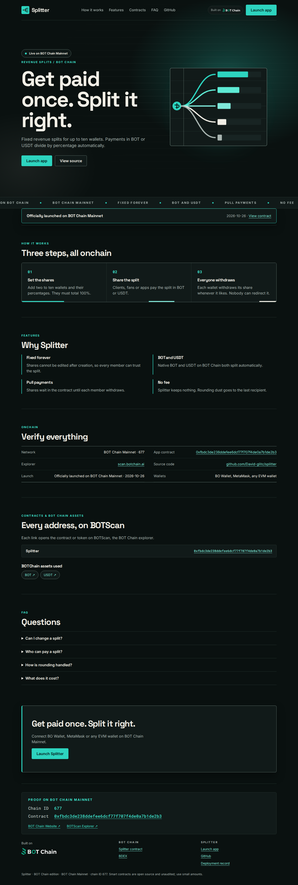

# Splitter

**Get paid once. Split it right.** Fixed revenue splits for up to ten wallets. Payments in BOT or USDT divide by percentage automatically.

**Status:** contracts are tested on a BOT Chain mainnet fork; the mainnet deployment is pending.

- Website and app: https://splitterbot.vercel.app (app at [`/app/`](https://splitterbot.vercel.app/app/))
- Network: BOT Chain mainnet, chain ID 677 · [BOT Chain](https://www.botchain.ai/) · [BOTScan](https://scan.botchain.ai/)



## How it works

1. **Set the shares.** Add two to ten wallets and their percentages. They must total 100%.
2. **Share the split.** Clients, fans or apps pay the split in BOT or USDT.
3. **Everyone withdraws.** Each wallet withdraws its share whenever it likes. Nobody can redirect it.

## Features

- **Fixed forever.** Shares cannot be edited after creation, so every member can trust the split.
- **BOT and USDT.** Native BOT and USDT on BOT Chain both split automatically.
- **Pull payments.** Shares wait in the contract until each member withdraws.
- **No fee.** Splitter keeps nothing. Rounding dust goes to the last recipient.

## Contracts

| Contract | BOT Chain mainnet |
|---|---|
| `Splitter` | Pending mainnet deployment |

BOT Chain infrastructure used: USDT `0xaBabc7Ddc03e501d190C676BF3d92ef0e6e87a3C`, WBOT `0xD5452816194a3784dBa983426cCe7c122F4abd30`, BDEX router `0x07032d47A1b9f8460cBeE9dC17c1d3E438693929`, BDEX QuoterV2 `0x034A705b36067cff99ABf5C662Be881cBd8d0176`.

Source: [`contracts/src`](contracts/src). Tests: [`contracts/test`](contracts/test). The contracts are unaudited; use small amounts.

## Develop

Requires Node 20+, [Foundry](https://getfoundry.sh) and Python 3.

```bash
git clone --recursive https://github.com/David-glitc/splitter.git
cd splitter
npm ci
npm test              # forge test
npm run build         # landing page + app into dist/splitter
npm run preview       # http://127.0.0.1:8771
```

`npm run build` writes `dist/splitter/index.html` (landing page), `dist/splitter/app/` (the dApp) and a Cloudflare Workers bundle under `sites/`.

### Wallets

The app discovers installed wallets with EIP-6963 (BO Wallet, MetaMask, OKX, Rabby and others) and falls back to `window.ethereum`. It switches or adds BOT Chain (chain ID `0x2a5`, RPC `https://rpc.botchain.ai`) before any transaction, and simulates every call before asking for a signature.

### Rehearse on a mainnet fork

```bash
anvil --fork-url https://rpc.botchain.ai --port 8677 --chain-id 677
export BOT_RPC_URL=http://127.0.0.1:8677
node scripts/deploy.mjs && node scripts/fork-check.mjs
```

### Deploy

`scripts/deploy.mjs` reads the deployer key from `BOT_SIGNER_FILE` (default `~/.config/botchain-wave1/deployer.env`, never committed), refuses to broadcast on mainnet without `BOT_MAX_GAS_BOT`, and journals every transaction to `deployments/mainnet.json` so it can resume. `npm run publish` deploys the built site to Vercel as a static production deployment.

## License

MIT. Built on [BOT Chain](https://www.botchain.ai/).
